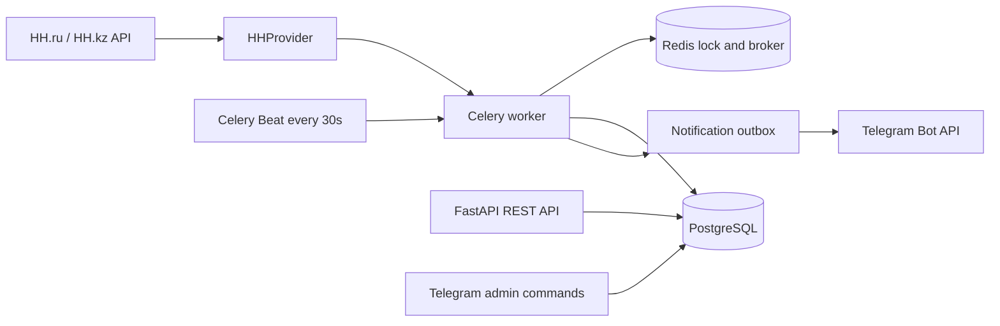

# Job Radar

Job Radar continuously searches HH.ru and HH.kz, stores normalized vacancies in PostgreSQL, applies deterministic profile rules, and delivers new matches to an administrator in Telegram. It is designed as a provider-based service: another job board can implement `BaseJobProvider` without changing the filtering, persistence, scheduler, or notification layers.

## Architecture



Celery is used for durable retries, late acknowledgements, and separate workers. Beat only dispatches due profiles; each profile retains its own interval (Mining Kazakhstan defaults to 15 minutes). A Redis lock prevents overlapping runs for the same profile. PostgreSQL unique constraints make vacancy and notification writes idempotent.

## Local setup

Requirements: Python 3.12+, Docker Compose v2, and a Telegram bot token. Copy `.env.example` to `.env` and set at least:

```env
TELEGRAM_BOT_TOKEN=123456:token
TELEGRAM_ADMIN_CHAT_ID=123456789
HH_ACCESS_TOKEN=oauth-token
HH_USER_AGENT=job-radar/0.1.0 (you@example.com)
POSTGRES_PASSWORD=use-a-long-random-password
```

The HH token is an OAuth access token. `HH-User-Agent` is mandatory and must identify the application and a contact address. HH hosts are selected per profile; `area_ids` must be used to restrict the region because selecting `hh.kz` alone does not restrict results to Kazakhstan.

Start everything on a Linux host:

```bash
cp .env.example .env
$EDITOR .env
scripts/bootstrap.sh
curl http://127.0.0.1:8000/health
curl http://127.0.0.1:8000/ready
```

PostgreSQL and Redis stay on the internal Compose network. The API binds to localhost; put nginx or Caddy in front of it later when HTTPS and a domain are ready.

## Telegram

Create a bot with BotFather, copy its token to `TELEGRAM_BOT_TOKEN`, start the bot, and send it a message. Use `getUpdates` or a small Telegram client to find the numeric chat ID and set `TELEGRAM_ADMIN_CHAT_ID`. The bot accepts read-only commands from that chat only:

- `/status` — service and profile counts;
- `/stats` — database counters;
- `/last` — most recently seen vacancy;
- `/profiles` — enabled/paused profiles.

No command changes profiles, triggers a run, or mutates a blacklist. Callback parsing already reserves `blacklist_employer:<id>` for a future employer blacklist feature. Telegram delivery uses an outbox and retries transient failures. Telegram has no idempotency key for `sendMessage`; if a request is accepted and the response is lost, a rare duplicate is possible.

## Search profiles and filtering

Profiles are edited through the REST API. If the database has no profiles, startup creates `Mining Kazakhstan` with the initial mining keywords, construction exclusions, HH.kz source, and a 900-second interval. All rules are data, not Python constants.

```bash
curl -H "X-API-Key: $API_KEY" http://127.0.0.1:8000/api/v1/search-profiles
curl -X POST -H 'Content-Type: application/json' -H "X-API-Key: $API_KEY" \
  http://127.0.0.1:8000/api/v1/search-profiles \
  -d '{"name":"Python Backend","search_text":"Python backend","source_host":"hh.ru","include_keywords":["python","backend"]}'
```

Filtering normalizes case, HTML, whitespace, punctuation, and `ё/е`. Include rules require the configured minimum number of hits; required rules all must match; any excluded keyword or employer rejects the vacancy. Salary, currency, area, schedule, employment, and experience filters are applied after normalization, and each result keeps match or reject reasons in PostgreSQL.

## Initial sync and deduplication

The first successful run for a profile is a baseline. It stores existing vacancies and match results without notifications unless `SEND_NOTIFICATIONS_ON_INITIAL_SYNC=true`. Later runs enqueue only new matching vacancies. A vacancy received through several profiles keeps every `MatchResult`, while the notification outbox has a unique `(vacancy, recipient)` key so one administrator receives it once.

Vacancies use `(source, external_id)` uniqueness and a content hash. Re-seen records update changed fields and timestamps; changed content does not create another notification for the same recipient.

## REST API

Available endpoints:

```text
GET    /health
GET    /ready
GET    /api/v1/vacancies
GET    /api/v1/vacancies/{id}
GET    /api/v1/search-profiles
POST   /api/v1/search-profiles
GET    /api/v1/search-profiles/{id}
PATCH  /api/v1/search-profiles/{id}
DELETE /api/v1/search-profiles/{id}
POST   /api/v1/search-profiles/{id}/run
GET    /api/v1/runs
GET    /api/v1/runs/{id}
GET    /api/v1/stats
```

Set `API_KEY` to protect the API with `X-API-Key`. Leave it empty only on a trusted development machine. `/docs` and `/redoc` can be disabled with `API_DOCS_ENABLED=false`.

## Migrations and operations

```bash
docker compose run --rm migrations
uv run alembic upgrade head
scripts/backup.sh
scripts/restore.sh backups/jobradar-YYYYMMDDTHHMMSSZ.dump
scripts/update.sh
```

`backup.sh` writes a PostgreSQL custom-format dump under `backups/`, which is ignored by Git. `restore.sh` stops writers and requires typing `RESTORE`. `update.sh` requires a clean checkout, fast-forwards `main`, builds, runs migrations, restarts services, and checks readiness. If the check fails, inspect logs and roll back the application image to the previous commit; review migration compatibility before any database rollback.

## Tests and checks

```bash
uv sync
uv run ruff check .
uv run ruff format --check .
uv run mypy app
uv run python -m pytest
docker compose config
```

Tests cover keyword and salary filtering, HTML and HH normalization, transient API retry, duplicate vacancy updates, baseline behavior, notification idempotency, Telegram formatting, and profile/run services. CI runs Ruff, format check, mypy, Alembic migrations, and pytest on every push and pull request with PostgreSQL and Redis services.

## VPS deployment

Install Docker Engine and Compose v2, clone the public repository, create `.env`, fill the HH and Telegram values, and run `scripts/bootstrap.sh`. Keep `.env` outside backups and Git. Schedule off-host copies of the `scripts/backup.sh` output and periodically test a restore on a separate database. Monitor `docker compose ps`, `/ready`, worker logs, failed `SearchRun` rows, and notification delivery errors.

The application never logs bot tokens, OAuth tokens, or full authorization headers. Containers run as a non-root user, use healthchecks, and restart automatically. Real HH and Telegram delivery require your credentials; automated tests use mocked HTTP and notifier boundaries.
